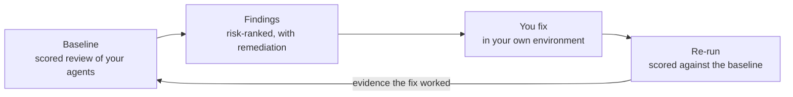

# Agent Review Program

> An expert-guided review, debugging and optimization, and validation service for your Copilot Studio
> agents, declarative agents, plugins, and skills.

The Agent Review Program pairs Microsoft experts with the **Agent Review Center** — a tool that runs
in your own environment and scores your agent against practices Microsoft teams have gathered across
customer engagements.

You get a scored baseline, risk-ranked findings with concrete remediation steps, and — once you have
made the fixes — a re-run measured against that baseline. The tool stays in your environment
afterward, so you can review your agents again whenever you want.

---

## What it is

| | |
|---|---|
| **Review** | Configuration, orchestration, knowledge and data grounding, and traces, checked against best practice. |
| **Debug** | Failure modes surfaced from your own transcripts and telemetry, not guesswork. |
| **Optimize** | Gaps named and ranked — including evals generated for you where you have none. |
| **Validate** | Fix, then prove the fix worked against your baseline. |

## What it checks

| Area | What we look at |
|---|---|
| **Configuration** | How the agent is set up: instructions, skills, tools, manifests, and the settings that shape its behavior. |
| **Orchestration** | How work is routed between agents, topics, and tools. Overlapping delegation triggers and contradictory guidance between parent and child agents are common and expensive. |
| **Knowledge and data grounding** | What the agent is grounded in, and whether its answers are actually supported by it. |
| **Traces** | Real runtime behavior from your own transcripts and telemetry: where conversations fail, what the agent actually did, and where users give up. |

Checks are grounded in field practice — each one tests the agent against best practices Microsoft
teams gathered across customer engagements. Findings cite their sources, including Microsoft Learn
and published references such as OWASP.

## What you get

| | |
|---|---|
| **Confidence** | You know whether the agent is ready to ship. |
| **Diagnosis** | Named failure modes instead of guesses about what is wrong. |
| **Priority** | A risk-ranked backlog, so the highest-impact fixes come first. |
| **Evidence** | A before-and-after score you can hand to stakeholders. |

### What a finding looks like

Findings are grouped by component area — Orchestration, for example — and each one carries:

| Field | What it tells you |
|---|---|
| **Severity** | How much it matters. Drives the order you work in. |
| **Finding ID** | A stable identifier, so you can track and discuss a specific finding. |
| **Title** | The problem in one line. |
| **Type** | The class of problem, such as `overlap` or `contradiction`. |
| **Agents affected** | Which of your agents the finding applies to. |
| **Explanation** | What is wrong, in plain language, with the parsed facts behind it. |
| **Impact** | What it costs you if it stays unfixed. |
| **Remediation** | What to do about it, plus concrete step-by-step actions. |
| **Detection and source** | How it was found and what practice or reference it is based on. |

An illustrative example:

> **HIGH · `XSK-01` · Overlapping delegation triggers across connected agents**
>
> **Type:** `overlap` · **Agents:** Central Copilot, Supplier Ops Assistant, Travel and Expense Assistant
>
> Central Copilot routes invoices, purchase orders, and procurement to Supplier Ops Assistant, and
> routes expense reports, claims, and reimbursements to Travel and Expense Assistant. But both child
> agents describe themselves as handling expense approvals and finance approvals. The boundary is
> ambiguous, so routing is unpredictable.
>
> **Remediation.** Draw one boundary between the two finance child agents and restate it identically
> in the parent routing rule and in both child agent instructions.
>
> 1. Decide which agent owns expense approvals.
> 2. Remove the losing claim from the other agent's instructions.
> 3. Update the parent routing rule to match.

A second example from the same family: **`XSK-03` · Contradictory guidance between parent and child
agents**, where conflicting escalation instructions suppress the escalation path that the parent's
own ticket-creation rule depends on. Neither of these is visible by reading one agent at a time.

## The Agent Review Center

The Agent Review Center is the tool behind the review. It runs in your own environment, against your
own agents.

| Capability | What it does |
|---|---|
| **Scored review result** | A rolled score across every agent reviewed — a grade and a number, such as `B+ · 87/100` — with per-agent tabs so you can see which agent is dragging the score. |
| **Review summary** | Total checks passed, broken down into passed, needs attention, and fail, plus the count of references cited. |
| **Findings list** | Every finding, expandable, filterable by component and status, showing parsed fact, impact, recommendation, and detection method. You can include or ignore a rule, or jump straight to editing the skill. |
| **Agent map** | How your agents connect, so routing and delegation problems are visible as structure, not buried in instructions. |
| **Runtime analysis** | Behavior from real runs, not just static configuration. |
| **Conversation analytics** | Coverage across your agents, conversations analyzed, detected risks, PII exposure, sentiment breakdown, and activity trends over time. |
| **Agent debugger** | Step through a failed conversation and see variable values and the steps the agent actually took. |
| **Rule packs** | Versioned sets of checks, so you know exactly which rules produced a result and can compare like with like. |
| **Snapshots and re-run** | Keep a snapshot of a review and run it again later. This is what turns "we changed some things" into a measured before-and-after. |
| **Share results** | Hand the scored result to your own stakeholders. |

Every run records its own metadata — when it ran, how long it took, the model used, whether memory
and web search were on, and its credit accounting — so a result is reproducible and auditable later.

## What you need to bring

| What | Detail |
|---|---|
| **A named owner with the right access** | One person who can work on the agent directly, with about **3–6 hours** across the engagement. |
| **Agreement to install the Agent Review Center** | It runs in **your own environment**, so your data stays in your tenant. |
| **An agent with a meaningful user base** | In testing, pilot, or production, with enough real traces for the failure modes to be informative. |
| **Premium Power Apps license** | Required to run the Agent Review Center. |
| **Copilot credits** | Running the review consumes credits in your tenant. |

An agent with little or no real traffic can still be reviewed for configuration and orchestration,
but the runtime and conversation analysis will have little to work with.

## Data handling

- **The tool runs in your environment.** The Agent Review Center is installed in your own tenant and
  runs against your own agents.
- **Your data stays in your tenant.** Transcripts, telemetry, and traces are analyzed where they
  already live.
- **You control what is shared.** Results are yours. Sharing them outside your team is your decision.

## How to get started

1. **Pick the agent or agents you want reviewed.** Something in testing, pilot, or production with a
   meaningful user base, and enough real traces for the findings to tell you something.
2. **Ask your Microsoft team.** Talk to the Microsoft team you already work with and ask them about
   the Agent Review Program.
3. **Name your owner and book the first slot** for discovery, Agent Review Center setup, and data
   preparation.

Not sure whether your agent is a fit? Ask your Microsoft contact — we will scope it with you
beforehand.

For questions about these docs, see [SUPPORT.md](SUPPORT.md).

---

## Contributing

This project welcomes contributions and suggestions.  Most contributions require you to agree to a
Contributor License Agreement (CLA) declaring that you have the right to, and actually do, grant us
the rights to use your contribution. For details, visit [Contributor License Agreements](https://cla.opensource.microsoft.com).

When you submit a pull request, a CLA bot will automatically determine whether you need to provide
a CLA and decorate the PR appropriately (e.g., status check, comment). Simply follow the instructions
provided by the bot. You will only need to do this once across all repos using our CLA.

This project has adopted the [Microsoft Open Source Code of Conduct](https://opensource.microsoft.com/codeofconduct/).
For more information see the [Code of Conduct FAQ](https://opensource.microsoft.com/codeofconduct/faq/) or
contact [opencode@microsoft.com](mailto:opencode@microsoft.com) with any additional questions or comments.

## Trademarks

This project may contain trademarks or logos for projects, products, or services. Authorized use of Microsoft
trademarks or logos is subject to and must follow
[Microsoft's Trademark & Brand Guidelines](https://www.microsoft.com/legal/intellectualproperty/trademarks/usage/general).
Use of Microsoft trademarks or logos in modified versions of this project must not cause confusion or imply Microsoft sponsorship.
Any use of third-party trademarks or logos are subject to those third-party's policies.
