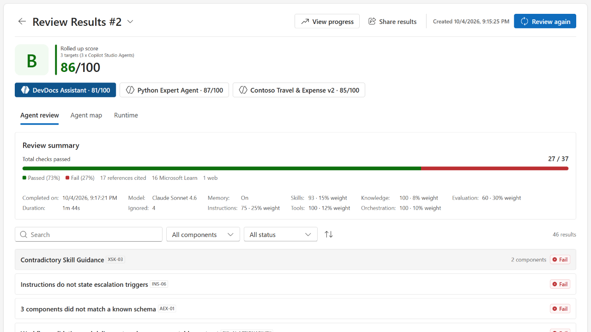
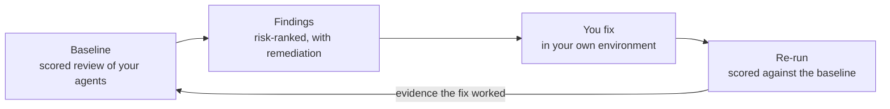
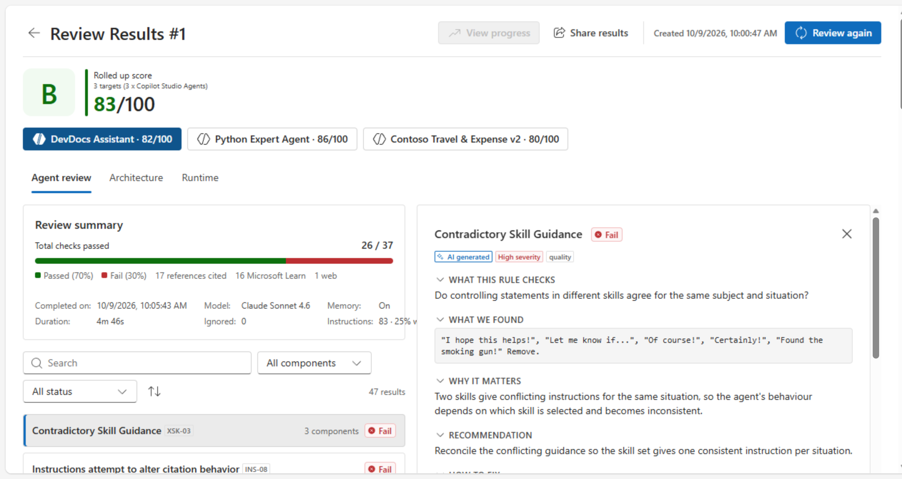
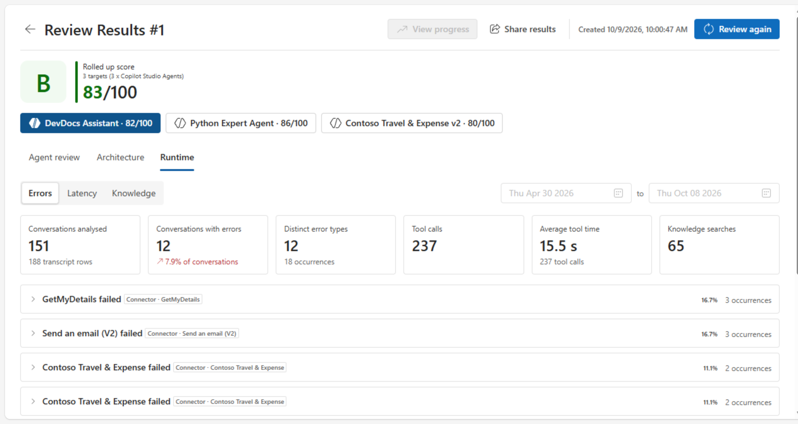
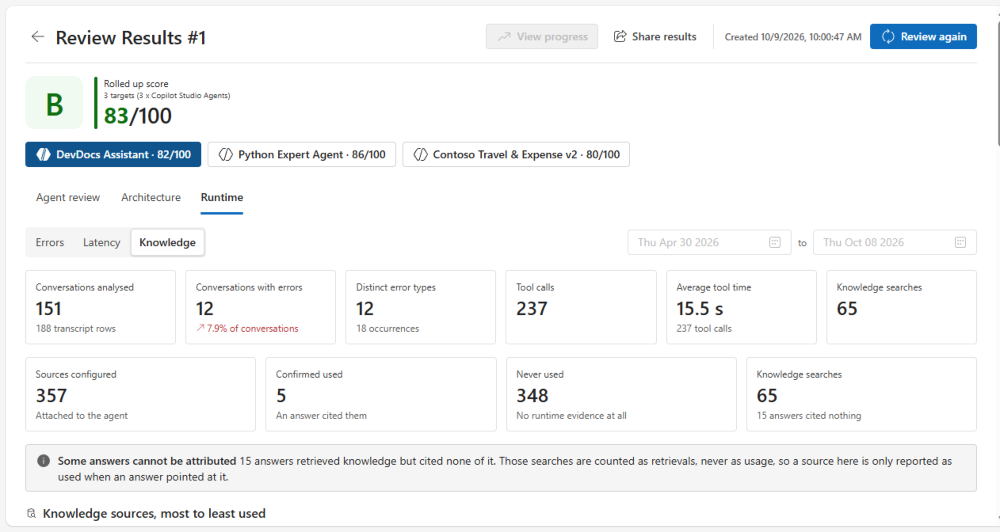
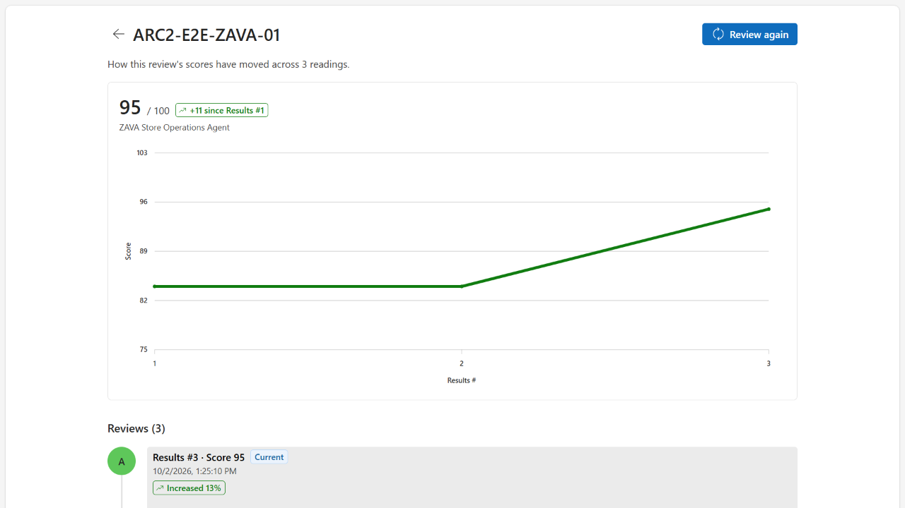

# Agent Review Program

> An expert-guided review, debugging and optimization, and validation service for your Copilot Studio
> agents, declarative agents, and skills.

**[Website](https://microsoft.github.io/AI-Solution-Review/)** ·
**[Download](#download)** ·
**[Prerequisites](guides/prerequisites.md)** ·
**[Install guide](guides/install.md)** ·
**[Run a review](guides/run-a-review.md)** ·
**[Troubleshooting](guides/troubleshooting.md)** ·
**[FAQ](guides/faq.md)** ·
**[Get help](SUPPORT.md)**

The Agent Review Program pairs Microsoft experts with the **Agent Review Center** — a tool that runs
in your own environment and scores your agent against practices Microsoft teams have gathered across
customer engagements.

You get a scored baseline, risk-ranked findings with concrete remediation steps, and — once you have
made the fixes — a re-run measured against that baseline. The tool stays in your environment
afterward, so you can review your agents again whenever you want.

---

## Documentation

| I want to… | Read |
|---|---|
| Understand the program and what the review covers | [What it is](#what-it-is) · [Website](https://microsoft.github.io/AI-Solution-Review/) |
| Check that my tenant is ready, or hand my admin a checklist | [Prerequisites](guides/prerequisites.md) |
| Get the solution file | [Download](#download) |
| Install and set up the Agent Review Center | [Install guide](guides/install.md) |
| Run my first review and read the results | [Run a review](guides/run-a-review.md) |
| Fix a setup or review problem | [Troubleshooting](guides/troubleshooting.md) |
| Find answers to common questions | [FAQ](guides/faq.md) |
| See what changed in each version | [Changelog](CHANGELOG.md) |
| Ask a question or report a problem with these docs | [Support](SUPPORT.md) |

## Download

The Agent Review Center ships as a Power Platform **managed solution**. Import it into a Power
Platform environment in your own tenant.

| | |
|---|---|
| **Latest version** | `20261016.1` — see the [changelog](CHANGELOG.md) |
| **File** | [`AgentReviewCenter_20261016.1_managed.zip`](AgentReviewCenter_20261016.1_managed.zip) (1.6 MB) |
| **Download** | [Latest release](https://github.com/microsoft/AI-Solution-Review/releases/latest) · [Direct download](https://github.com/microsoft/AI-Solution-Review/raw/main/AgentReviewCenter_20261016.1_managed.zip) |
| **SHA-256** | `DBBF03DCCC2F4F6E208D5BFF70C2260A13E11AC2F74B6CE2AE07DD9673BB364B` |

Import the `.zip` as-is — do not extract it. Get the [prerequisites](guides/prerequisites.md) in
place first, then follow the [install guide](guides/install.md).

## Quick start

1. **Send the [prerequisites checklist](guides/prerequisites.md) to your Power Platform admin.**
   Licenses, a standard Dataverse environment, code apps, and transcript settings.
2. **Turn on transcript recording now.** It is not retroactive — nothing recorded before you switch
   it on can be analyzed.
3. **[Import the solution](guides/install.md#3-import-the-solution)** into the environment that holds
   the agents you want reviewed.
4. **[Run the setup app once](guides/install.md#4-run-the-setup-app-once)** to connect the solution
   and start its review workflow.
5. **[Open the Agent Review Center](guides/install.md#5-clear-the-readiness-checklist)**, clear the
   readiness checklist, and select **Add review**. See [Run a review](guides/run-a-review.md).

---

## What it is

| | |
|---|---|
| **Review** | Configuration, orchestration, knowledge and data grounding, and traces, checked against best practice. |
| **Debug** | Failure modes surfaced from your own transcripts and telemetry, not guesswork. |
| **Optimize** | Gaps named and ranked — including evals generated for you where you have none. |
| **Validate** | Fix, then prove the fix worked against your baseline. |

## What it checks

| Area | What we look at |
|---|---|
| **Configuration** | How the agent is set up: instructions, skills, tools, manifests, and the settings that shape its behavior. |
| **Orchestration** | How work is routed between agents, topics, and tools. Overlapping delegation triggers and contradictory guidance between parent and child agents are common and expensive. |
| **Knowledge and data grounding** | What the agent is grounded in, and whether its answers are actually supported by it. |
| **Traces** | Real runtime behavior from your own transcripts and telemetry: where conversations fail, what the agent actually did, and where users give up. |

Checks are grounded in field practice — each one tests the agent against best practices Microsoft
teams gathered across customer engagements. Findings cite their sources, including Microsoft Learn
and published references such as OWASP.

## What you get

| | |
|---|---|
| **Confidence** | You know whether the agent is ready to ship. |
| **Diagnosis** | Named failure modes instead of guesses about what is wrong. |
| **Priority** | A risk-ranked backlog, so the highest-impact fixes come first. |
| **Evidence** | A before-and-after score you can hand to stakeholders. |

<table>
  <tr>
    <td width="50%"> <b>Every finding</b> names the failure, why it matters, and the fix — each one citing its source.</td>
    <td width="50%"> <b>Runtime analysis</b> pulls failures from your own transcripts — not a lab test.</td>
  </tr>
  <tr>
    <td width="50%"> <b>Knowledge usage</b> measures the grounding you configured against what the agent actually cites.</td>
    <td width="50%"> <b>Score progress</b> shows each re-run against your baseline.</td>
  </tr>
</table>

Screenshots are from a sample review of demo agents.

## The Agent Review Center

The Agent Review Center is the tool behind the review. It runs in your own environment, against your
own agents.

| Capability | What it does |
|---|---|
| **Scored review result** | A rolled score across every agent reviewed — a grade and a number, such as `B · 83/100` — with per-agent tabs so you can see which agent is dragging the score. |
| **Review summary** | Total checks passed, broken down into passed and failed, plus the count of references cited. |
| **Findings list** | Every finding, expandable, filterable by component and status, showing what the rule checks, what was found, why it matters, and how to fix it. You can mark a rule as a manual pass where it does not apply. |
| **Agent map** | How your agents connect, so routing and delegation problems are visible as structure, not buried in instructions. |
| **Runtime analysis** | Behavior from real runs, not just static configuration: errors, latency, tool calls, and knowledge usage from your conversation transcripts. |
| **Agent debugger** | Step through a conversation and see the steps the agent actually took, variable values, tool calls, and a performance timeline. |
| **Rule packs** | Versioned sets of checks, so you know exactly which rules produced a result and can compare like with like. |
| **Snapshots and re-run** | Keep a snapshot of a review and run it again later. This is what turns "we changed some things" into a measured before-and-after. |
| **Share results** | Download the scored result as a PDF or JSON report for your own stakeholders. |

You can review three kinds of asset: **Copilot Studio agents** in your environment, and
**declarative agents** and **skills** uploaded as files.

Every run records its own metadata — when it ran, how long it took, the model used, and whether
memory and web search were on — so a result is reproducible and auditable later.

## What you need to bring

| What | Detail |
|---|---|
| **A named owner with the right access** | One person who can work on the agent directly, with about **3–6 hours** across the engagement. |
| **Agreement to install the Agent Review Center** | It is installed and runs in **your own environment**. See the [install guide](guides/install.md). |
| **An agent with a meaningful user base** | In testing, pilot, or production, with enough real traces for the failure modes to be informative. |
| **Licensing and credits** | A Copilot Studio license, Power Apps Premium, and Copilot Credits. See [Prerequisites](guides/prerequisites.md). |

An agent with little or no real traffic can still be reviewed for configuration and orchestration,
but the runtime analysis will have little to work with.

## Data handling

- **The tool runs in your environment.** The Agent Review Center is installed in, and runs in, a
  Power Platform environment in your own tenant, against your own agents.
- **Results are stored there.** Reviews and results are stored in Dataverse tables in the
  environment where you install the tool.
- **You control what is shared.** Results are yours. Sharing them outside your team is your decision.

For detailed data-handling questions, ask your Microsoft contact. See the
[FAQ](guides/faq.md#data-and-security) for what the solution installs and which connectors it uses.

## How to get started

1. **Pick the agent or agents you want reviewed.** Something in testing, pilot, or production with a
   meaningful user base, and enough real traces for the findings to tell you something.
2. **Nominate your agent.** Use the [nomination options on the website](https://microsoft.github.io/AI-Solution-Review/#nominate),
   or ask the Microsoft team you already work with about the Agent Review Program.
3. **Start the setup early.** Get the [prerequisites](guides/prerequisites.md) in front of your
   tenant admin, and turn on transcript recording as soon as you can.
4. **Name your owner and book the first slot** for discovery, Agent Review Center setup, and data
   preparation.

Not sure whether your agent is a fit? Ask your Microsoft contact — we will scope it with you
beforehand.

For questions, see [SUPPORT.md](SUPPORT.md).

---

## Contributing

This project welcomes contributions and suggestions.  Most contributions require you to agree to a
Contributor License Agreement (CLA) declaring that you have the right to, and actually do, grant us
the rights to use your contribution. For details, visit [Contributor License Agreements](https://cla.opensource.microsoft.com).

When you submit a pull request, a CLA bot will automatically determine whether you need to provide
a CLA and decorate the PR appropriately (e.g., status check, comment). Simply follow the instructions
provided by the bot. You will only need to do this once across all repos using our CLA.

This project has adopted the [Microsoft Open Source Code of Conduct](https://opensource.microsoft.com/codeofconduct/).
For more information see the [Code of Conduct FAQ](https://opensource.microsoft.com/codeofconduct/faq/) or
contact [opencode@microsoft.com](mailto:opencode@microsoft.com) with any additional questions or comments.

## Trademarks

This project may contain trademarks or logos for projects, products, or services. Authorized use of Microsoft
trademarks or logos is subject to and must follow
[Microsoft's Trademark & Brand Guidelines](https://www.microsoft.com/legal/intellectualproperty/trademarks/usage/general).
Use of Microsoft trademarks or logos in modified versions of this project must not cause confusion or imply Microsoft sponsorship.
Any use of third-party trademarks or logos are subject to those third-party's policies.
