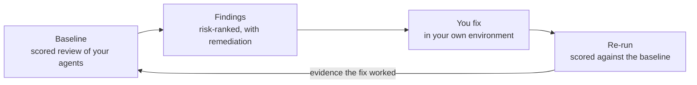

# Agent Review Program

> An expert-guided review, debugging and optimization, and validation service for your Copilot Studio
> agents, declarative agents, plugins, and skills.

The Agent Review Program pairs Microsoft experts with the **Agent Review Center** — a tool that runs
in your own environment and scores your agent against practices Microsoft teams have gathered across
customer engagements.

You get a scored baseline, risk-ranked findings with concrete remediation steps, and — once you have
made the fixes — a re-run measured against that baseline. The tool stays in your environment
afterward, so you can review your agents again whenever you want.

---

## What it is

| | |
|---|---|
| **Review** | Configuration, orchestration, knowledge and data grounding, and traces, checked against best practice. |
| **Debug** | Failure modes surfaced from your own transcripts and telemetry, not guesswork. |
| **Optimize** | Gaps named and ranked — including evals generated for you where you have none. |
| **Validate** | Fix, then prove the fix worked against your baseline. |

## What it checks

| Area | What we look at |
|---|---|
| **Configuration** | How the agent is set up: instructions, skills, tools, manifests, and the settings that shape its behavior. |
| **Orchestration** | How work is routed between agents, topics, and tools. Overlapping delegation triggers and contradictory guidance between parent and child agents are common and expensive. |
| **Knowledge and data grounding** | What the agent is grounded in, and whether its answers are actually supported by it. |
| **Traces** | Real runtime behavior from your own transcripts and telemetry: where conversations fail, what the agent actually did, and where users give up. |

Checks are grounded in field practice — each one tests the agent against best practices Microsoft
teams gathered across customer engagements. Findings cite their sources, including Microsoft Learn
and published references such as OWASP.

## What you get

| | |
|---|---|
| **Confidence** | You know whether the agent is ready to ship. |
| **Diagnosis** | Named failure modes instead of guesses about what is wrong. |
| **Priority** | A risk-ranked backlog, so the highest-impact fixes come first. |
| **Evidence** | A before-and-after score you can hand to stakeholders. |

## The Agent Review Center

The Agent Review Center is the tool behind the review. It runs in your own environment, against your
own agents.

| Capability | What it does |
|---|---|
| **Scored review result** | A rolled score across every agent reviewed — a grade and a number, such as `B+ · 87/100` — with per-agent tabs so you can see which agent is dragging the score. |
| **Review summary** | Total checks passed, broken down into passed, needs attention, and fail, plus the count of references cited. |
| **Findings list** | Every finding, expandable, filterable by component and status, showing parsed fact, impact, recommendation, and detection method. You can include or ignore a rule, or jump straight to editing the skill. |
| **Agent map** | How your agents connect, so routing and delegation problems are visible as structure, not buried in instructions. |
| **Runtime analysis** | Behavior from real runs, not just static configuration. |
| **Conversation analytics** | Coverage across your agents, conversations analyzed, detected risks, PII exposure, sentiment breakdown, and activity trends over time. |
| **Agent debugger** | Step through a failed conversation and see variable values and the steps the agent actually took. |
| **Rule packs** | Versioned sets of checks, so you know exactly which rules produced a result and can compare like with like. |
| **Snapshots and re-run** | Keep a snapshot of a review and run it again later. This is what turns "we changed some things" into a measured before-and-after. |
| **Share results** | Hand the scored result to your own stakeholders. |

Every run records its own metadata — when it ran, how long it took, the model used, whether memory
and web search were on, and its credit accounting — so a result is reproducible and auditable later.

## What you need to bring

| What | Detail |
|---|---|
| **A named owner with the right access** | One person who can work on the agent directly, with about **3–6 hours** across the engagement. |
| **Agreement to install the Agent Review Center** | It runs in **your own environment**, so your data stays in your tenant. See [Install the Agent Review Center](#install-the-agent-review-center). |
| **An agent with a meaningful user base** | In testing, pilot, or production, with enough real traces for the failure modes to be informative. |
| **Licensing and credits** | A Copilot Studio license, a Power Apps Premium license, and Copilot credits. See [Prerequisites](#prerequisites). |

An agent with little or no real traffic can still be reviewed for configuration and orchestration,
but the runtime and conversation analysis will have little to work with.

## Install the Agent Review Center

The Agent Review Center is installed as part of the **Copilot Agent Kit**, an open-source toolkit for
Copilot Studio agents. It goes into a Power Platform environment in your own tenant.

Start this before your first working session. The tenant admin approvals and the transcript setting
are the two things most likely to hold up a review, and neither is quick to arrange on the day.

> The Copilot Agent Kit documentation refers to the underlying capability as the **Agent Review
> Tool**. It is the same thing you will see described here as the Agent Review Center.

### Prerequisites

**Licensing — tenant level**

| Requirement | Why |
|---|---|
| **Copilot Studio license** | The agents under review run on it. |
| **Power Apps Premium license** | Required to run the app and the Power Automate cloud flows that use Premium connectors. |
| **Copilot credits** | Running a review consumes credits. Credits must also be allocated to the environment where the Agent Review Center runs, not only owned at tenant level. |

**Environment configuration — needs a system administrator**

| Setting | Notes |
|---|---|
| **Dataverse provisioned** | The environment must [have Dataverse as a data store](https://learn.microsoft.com/en-us/power-platform/admin/create-environment). Configuration and results are stored there. |
| **Not a preview environment** | Use a standard environment. |
| **Code apps enabled** | [Enable Power Apps Code Apps](https://learn.microsoft.com/en-us/power-apps/developer/code-apps/overview#enable-code-apps-on-a-power-platform-environment) on the environment. |
| **Power Apps component framework enabled** | [Enable the component framework for canvas apps](https://learn.microsoft.com/en-us/power-apps/developer/component-framework/component-framework-for-canvas-apps#enable-the-power-apps-component-framework-feature). |
| **Bot transcripts enabled** | Required for runtime analysis and conversation analytics. See the note below — turn this on early. |
| **Creator Kit deployed** | A required dependency. [Set up the Creator Kit](https://learn.microsoft.com/en-us/power-platform/guidance/creator-kit/setup) first. |
| **Connectors allowed by data policy** | Your environment's [data loss prevention policies](https://learn.microsoft.com/en-us/power-platform/admin/wp-data-loss-prevention) must permit every connector shipped in the solution, and connections must be populated at import time — regardless of which features you plan to use. |

**Access and roles**

Two environments can be involved: the one where the Agent Review Center runs, and the one where the
agent being reviewed lives. They can be the same environment, but they do not have to be.

| Where | What your tenant admin grants |
|---|---|
| **Environment running the Agent Review Center** | System administrator to perform the install. For the review owner: a security role that can read the Agent Review Center tables, and direct access to the Agent Review Center code app. |
| **Environment holding the agent under review** | **Agent Maker**, so the owner can work on the agent. **Bot Transcript Viewer**, so conversation transcripts can be read. Transcript access is [governed by environment security roles](https://learn.microsoft.com/en-us/microsoft-copilot-studio/admin-share-bots). |

Full detail is in the [Copilot Agent Kit prerequisites](https://learn.microsoft.com/en-us/microsoft-copilot-studio/guidance/kit-prerequisites).

### Turn on transcripts early

**Transcript recording is not retroactive.** Nothing is backfilled. If recording is switched on the
day before the review starts, there is almost no history to analyze, and the runtime and
conversation analysis will have little to say.

Two things to tell your admin:

- Transcript recording is an **environment setting**, so it applies to agents in that environment,
  not only the ones under review. Environment-group policies can override a per-environment setting.
- **Retention is configurable.** Check that the retention window covers the period you want reviewed.

After switching it on, run a test conversation and confirm a transcript row actually appears before
you rely on it.

### Install

| Step | What to do |
|---|---|
| **1. Check prerequisites** | Work through [Copilot Agent Kit prerequisites](https://learn.microsoft.com/en-us/microsoft-copilot-studio/guidance/kit-prerequisites) before downloading anything. |
| **2. Install the kit** | From [Marketplace](https://aka.ms/DownloadCopilotStudioKit), or import the latest managed solution from the [GitHub releases](https://github.com/microsoft/Power-CAT-Copilot-Studio-Kit/releases/latest). Full steps: [Install Copilot Agent Kit](https://learn.microsoft.com/en-us/microsoft-copilot-studio/guidance/kit-install). |
| **3. Configure connection references** | In Power Apps, open the default solution and make sure the **Copilot Agent Kit - Dataverse** connection reference is valid. |
| **4. Enable the cloud flows** | In Power Automate, confirm every flow in the solution is on. Enable them in order: flows ending in **Grandchild**, then **Child**, then the rest. |
| **5. Finish in the Setup Wizard** | The kit includes a [Setup Wizard](https://learn.microsoft.com/en-us/microsoft-copilot-studio/guidance/kit-setup-wizard) for connection references, environment variables, and flows. The **Agents (preview)** connector used by the review workflow cannot be configured during solution import — skip it at import and complete it in the Setup Wizard. |

If you are already scoping a review with your Microsoft contact, they can walk your admin through
this. You do not have to get it all working alone before you talk to us.

## Data handling

- **The tool runs in your environment.** The Agent Review Center is installed in your own tenant and
  runs against your own agents.
- **Your data stays in your tenant.** Transcripts, telemetry, and traces are analyzed where they
  already live.
- **You control what is shared.** Results are yours. Sharing them outside your team is your decision.

## How to get started

1. **Pick the agent or agents you want reviewed.** Something in testing, pilot, or production with a
   meaningful user base, and enough real traces for the findings to tell you something.
2. **Ask your Microsoft team.** Talk to the Microsoft team you already work with and ask them about
   the Agent Review Program.
3. **Start the setup early.** Get the [prerequisites and permissions](#install-the-agent-review-center)
   in front of your tenant admin, and turn on transcript recording as soon as you can.
4. **Name your owner and book the first slot** for discovery, Agent Review Center setup, and data
   preparation.

Not sure whether your agent is a fit? Ask your Microsoft contact — we will scope it with you
beforehand.

For questions about these docs, see [SUPPORT.md](SUPPORT.md).

---

## Contributing

This project welcomes contributions and suggestions.  Most contributions require you to agree to a
Contributor License Agreement (CLA) declaring that you have the right to, and actually do, grant us
the rights to use your contribution. For details, visit [Contributor License Agreements](https://cla.opensource.microsoft.com).

When you submit a pull request, a CLA bot will automatically determine whether you need to provide
a CLA and decorate the PR appropriately (e.g., status check, comment). Simply follow the instructions
provided by the bot. You will only need to do this once across all repos using our CLA.

This project has adopted the [Microsoft Open Source Code of Conduct](https://opensource.microsoft.com/codeofconduct/).
For more information see the [Code of Conduct FAQ](https://opensource.microsoft.com/codeofconduct/faq/) or
contact [opencode@microsoft.com](mailto:opencode@microsoft.com) with any additional questions or comments.

## Trademarks

This project may contain trademarks or logos for projects, products, or services. Authorized use of Microsoft
trademarks or logos is subject to and must follow
[Microsoft's Trademark & Brand Guidelines](https://www.microsoft.com/legal/intellectualproperty/trademarks/usage/general).
Use of Microsoft trademarks or logos in modified versions of this project must not cause confusion or imply Microsoft sponsorship.
Any use of third-party trademarks or logos are subject to those third-party's policies.
