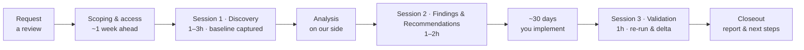

# AI Solution Review

A short, expert-led review of a working AI agent. Three sessions over about 30 days give you a clear
picture of how your agent actually behaves, why it underperforms, a prioritized list of fixes, and a
measured before-and-after check that those fixes worked.

---

## What it is

The AI Solution Review is a structured, time-boxed engagement delivered by the Microsoft team that
builds agent assessment tooling. We look at your agent as it actually runs — its configuration,
instructions, tools, and behavior in real usage — and turn that into findings your team can act on.

The review is built around one idea: **measure, fix, then measure again the same way.** We capture a
baseline assessment of your agent in Session 1 and re-run that same assessment in Session 3. The
difference between the two is your evidence that the agent improved.

**It is for you if:**

- You have an agent that is working, or close to working, aimed at a meaningful number of users.
- You are heading toward production, or toward a significantly larger rollout.
- You want to know what will break before your users find it.
- You need something concrete to put in front of a decision maker before you scale.

## The problem it addresses

| What teams run into | Why it hurts |
|---|---|
| Problems surface only after an incident | There is no early warning. Issues show up in production instead of before it. |
| You can tell the agent is misbehaving, but not where | Without root cause, teams guess. Is it configuration, the platform, or prompting and orchestration? |
| No baseline, so no proof of improvement | Nothing to measure "before" against "after." Improvements can't be demonstrated or trusted ahead of scaling. |

Agent problems are rarely just errors. Cost, latency, answer quality, users abandoning a task
part-way, and user sentiment all matter — and none of them show up in an error log.

## What you get

| Deliverable | When | What it's for |
|---|---|---|
| **Baseline assessment** | Session 1 | A recorded, frozen picture of how your agent behaves today. It is not overwritten later, so the comparison stays honest. |
| **Findings report** | Session 2 | What we found, ranked by severity, with the evidence behind each finding. |
| **Prioritized recommendations** | Session 2 | A concrete fix list with impact and effort on each item, so you can decide what to do first. |
| **Validation re-run and delta** | Session 3 | The same assessment run again, with the before-and-after difference. |
| **Closeout summary** | Session 3 | The outcome, any residual risk in writing, and where to go next for deeper or ongoing work. |

The findings report and the delta are yours. They are written to be readable by an engineer and
defensible to an executive.

## How the review works

Three sessions, roughly 3–6 hours of your team's time in total, with an implementation window of
about 30 days built into the middle.

| Stage | Your time | What happens | What comes out of it |
|---|---|---|---|
| **Scoping & access** | Short async prep | We confirm the review is a fit, agree which agents are in scope, and your admin arranges the access the review needs. | Confirmed scope, access in place, Session 1 booked |
| **Session 1 · Discovery** | 1–3 hours | We walk your agent with you, agree what is in and out of scope, and capture the baseline assessment and supporting evidence. | Frozen baseline |
| **Analysis** | None | We turn the baseline into findings and a prioritized set of recommendations. | Draft findings |
| **Session 2 · Findings & Recommendations** | 1–2 hours | We present what we found and why. You decide what you will implement, who owns each item, and by when. The ~30-day clock starts, and Session 3 goes on the calendar. | Report, committed action list, Session 3 booked |
| **Implementation window** | Your team's own work | You implement the changes you committed to. | Agent ready for validation |
| **Session 3 · Validation** | 1 hour | We re-run the same assessment against the same kind of data window and show the difference. | Validation score, baseline-to-validation delta, closeout |

Two things make the comparison trustworthy, and we hold to them:

- **The baseline is frozen.** The Session 1 assessment is stored as-is. A re-run never overwrites it.
- **The re-run matches the baseline.** Same assessment, same method, same data window length. If
  something changed underneath that affects the comparison, we say so in the report rather than
  quietly absorbing it.

## What we need from you

| What | Why it matters |
|---|---|
| A working or in-progress agent | The review analyzes a running system. There needs to be something to look at. |
| A named technical owner | One person who knows the agent and can answer questions during the sessions. |
| Someone who can implement fixes | Ideally the same person, and with the authority to make changes without a further approval round. |
| Agreed data access, arranged ahead of Session 1 | Access typically needs an admin and a change window. Start this about a week before Session 1. |
| Logging and telemetry switched on early | Usage history is generally not backfilled. If recording is turned on the day before Session 1, there is little to analyze. The earlier it is on, the deeper the review can go. |
| Attendance at all three sessions | Session 2 and Session 3 dates are agreed during Session 1 so the window is realistic for your team. |
| Ownership of the fixes | You own the implementation during the ~30-day window. We do not make changes to your agent for you. |
| The two or three areas you want reviewed | Telling us where it hurts most makes Session 1 faster and the findings sharper. |

If the recommendations aren't implemented during the window, there is nothing to re-measure, and the
review closes without a validation session. The window length is agreed with you at Session 2, so
set one your team can actually meet.

## What this is not

- **Not break/fix or support escalation.** If you have a live production incident, go through
  Microsoft Support. This review is a scheduled engagement, not an incident channel.
- **Not open-ended consulting.** It is three sessions with a defined start and end, not an
  ongoing advisory relationship.
- **Not an architecture design engagement.** We review the running system and its behavior data. A
  design engagement reviews intent and architecture choices. They are different engagements, and the
  review can hand off into deeper work if you need it.
- **Not a rubber stamp.** "Don't scale this yet, and here's the evidence why" is a valid and
  expected outcome. The decision to ship stays yours.

## Data handling and privacy

Our default posture is deliberately conservative:

- **Your tenant, your screen.** Analysis runs against your environment, driven by you in a
  screen-share. You stay in control of what is shown.
- **No customer data at rest by default.** We do not take your conversation data away with us.
- **Every data type has a recorded reason.** If we look at something, there is a written rationale
  for why the review needed it.
- **Sharing is opt-in and explicit.** We ask separately, and in advance, before any report is shared
  beyond your team or before your organization is named in anything.

If a review needs anything beyond this posture, we agree it with you in writing before it starts.

## Get started

1. **Talk to your Microsoft account team** — your account executive, Cloud Solution Architect, or
   Customer Program Manager. Ask them to submit an AI Solution Review request for your agent.
2. **Tell them what to look at** — the agent or agents in scope, roughly how many users it is aimed
   at, where you are in the build, and the two or three things worrying you most.
3. **We confirm fit and book Session 1** — including the access your admin needs to arrange first.

If you are not sure who your account team is, or you have a question about how the review works,
[open an issue](../../issues) in this repository. See [SUPPORT.md](SUPPORT.md) for what this
repository is and is not the right place for.

---

## Contributing

This project welcomes contributions and suggestions.  Most contributions require you to agree to a
Contributor License Agreement (CLA) declaring that you have the right to, and actually do, grant us
the rights to use your contribution. For details, visit [Contributor License Agreements](https://cla.opensource.microsoft.com).

When you submit a pull request, a CLA bot will automatically determine whether you need to provide
a CLA and decorate the PR appropriately (e.g., status check, comment). Simply follow the instructions
provided by the bot. You will only need to do this once across all repos using our CLA.

This project has adopted the [Microsoft Open Source Code of Conduct](https://opensource.microsoft.com/codeofconduct/).
For more information see the [Code of Conduct FAQ](https://opensource.microsoft.com/codeofconduct/faq/) or
contact [opencode@microsoft.com](mailto:opencode@microsoft.com) with any additional questions or comments.

## Trademarks

This project may contain trademarks or logos for projects, products, or services. Authorized use of Microsoft
trademarks or logos is subject to and must follow
[Microsoft's Trademark & Brand Guidelines](https://www.microsoft.com/legal/intellectualproperty/trademarks/usage/general).
Use of Microsoft trademarks or logos in modified versions of this project must not cause confusion or imply Microsoft sponsorship.
Any use of third-party trademarks or logos are subject to those third-party's policies.
